# Relaciones de la base VcM

El maestro es `cases`. Eventos e iniciativas usan proyectos; registros P5.1/P5.2 se relacionan al expediente. Los IDs externos se almacenan por proveedor, sin sustituir la identidad interna.

```mermaid
erDiagram
    CASES ||--o{ SOURCES : captura
    CASES ||--o{ CASE_FIELDS : contiene
    CASE_FIELDS ||--o{ FIELD_ASSERTIONS : versiones
    SOURCES ||--o{ FIELD_ASSERTIONS : fundamenta
    CASES ||--o{ EVIDENCES : sustenta
    DOCUMENT_REFERENCES ||--o{ EVIDENCES : referencia
    PROJECTS ||--o{ PROJECT_CASES : ejecuta
    CASES ||--o{ PROJECT_CASES : vincula
    PROJECTS ||--o{ TASKS : organiza
    PROJECTS ||--o{ BUDGET_ITEMS : planifica
    BUDGET_ITEMS ||--o{ EXPENSES : ejecuta
    PROJECTS ||--o{ COMMITMENTS : compromete
    COMMITMENTS ||--o{ COMMITMENT_EXPENSES : descuenta
    EXPENSES ||--o| COMMITMENT_EXPENSES : imputa
    CASES ||--o{ DECISIONS : requiere
    DECISIONS ||--o{ DECISION_REVISIONS : propone
    PROTECTED_OBJECTS ||--o{ OBJECT_REVISIONS : versiona
    OBJECT_REVISIONS ||--o{ APPROVAL_RECORDS : autoriza
    CASES ||--o{ CAMPAIGNS : orienta
    CAMPAIGNS ||--o{ CAMPAIGN_REVISIONS : estrategia
    CAMPAIGNS o|--o{ CONTENTS : origina
    CONTENTS ||--o{ CONTENT_REVISIONS : redacta
    PACKAGE_REVISIONS ||--o{ PACKAGE_ITEMS : agrupa
    CONTENT_REVISIONS ||--o{ PACKAGE_ITEMS : revisa
    CASES ||--o| PRESENCE_RECORDS : presencia
    CASES ||--o| ACTIVITY_RECORDS : actividad
    INDICATORS ||--o{ INDICATOR_TARGETS : meta
    INDICATORS ||--o{ INDICATOR_CONTRIBUTIONS : aporta
    INDICATOR_CONTRIBUTIONS ||--o{ CONTRIBUTION_EVIDENCES : demuestra
    CASE_SNAPSHOTS ||--o{ CUT_CASES : congela
    PRINCIPALS ||--o{ OBJECT_GRANTS : accede
    PROTECTED_OBJECTS ||--o{ AUDIT_EVENTS : registra
    PROTECTED_OBJECTS ||--o{ OUTBOX_EVENTS : notifica
    AUTOMATION_RULE_VERSIONS ||--o{ JOBS : programa
```

Confidencialidad en `protected_objects` para expedientes, decisiones, documentos, convenios, proyectos, partidas, campañas, contenidos, paquetes, planes y cortes. Sus relaciones no conceden lectura de un objeto más reservado.

`object_revisions` es un registro de identidad/versiones; el contenido está en las tablas de revisión por dominio. `approval_records(object_id,revision_id)` apunta mediante FK compuesta a la revisión del objeto correspondiente. Una revisión nueva no hereda aprobaciones.

`field_assertions` es captura inmutable, no una colección arbitraria de valores de negocio. Contiene columnas tipadas y referencias normalizadas; la selección del campo apunta a una afirmación del mismo campo y expediente. La documentación de todas las columnas, claves e índices está en [dictionary.md](dictionary.md).

El diagrama resume las relaciones principales; las claves físicas completas y tablas auxiliares están en el diccionario generado. No implica que exista ya API o autorización productiva.
