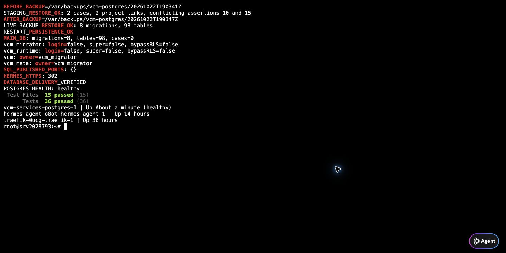

# Base relacional VcM — entrega verificada

22 de octubre de 2026. Se completó la entrega de base de datos del plan `docs/superpowers/plans/2026-10-22-bd-relacional.md`. La API, la persistencia web conectada y la skill de Hermes todavía corresponden a las entregas posteriores.

## Resultado

- PostgreSQL **18.6** en el VPS existente, base **vcm**, esquema de negocio **vcm** y registro de migraciones **vcm_meta**.
- **8 migraciones, 98 tablas**, claves foráneas, revisiones y catálogos versionados; **49 campos oficiales P5.2 y 7 tipologías P5.1**. Las tablas incluyen relaciones y versiones históricas, no 98 módulos de interfaz.
- Base principal con **cero expedientes de prueba**. No se importó localStorage ni se crearon usuarios humanos de acceso.
- `vcm_migrator` es propietario de los esquemas; `vcm_runtime` tiene permisos limitados. Ambos **NOLOGIN**, sin superusuario ni BYPASSRLS; no se otorgaron credenciales de conexión a API o Hermes.
- PostgreSQL sigue en red privada, sin puertos publicados. La plataforma sigue destinada a Hostinger Apps.

[Diccionario físico](../data/dictionary.md), [relaciones](../data/relationships.md), [mapeo P5.2](../data/p52-mapping.csv), [migraciones](../../database/migrations), [recuperación](../../infra/vps/postgres/README.md).

## Pruebas y revisión

| Verificación | Resultado |
|---|---|
| Base de datos local PostgreSQL 18.4 | 36 pruebas, 15 archivos, aprobadas |
| Base de datos VPS PostgreSQL 18.6 | 36 pruebas, 15 archivos, aprobadas; salida 0, sin errores no controlados |
| TypeScript del paquete database | aprobado |
| Frontend | 257 pruebas, 57 archivos, aprobadas |
| Build frontend | aprobado |
| ESLint final | 385 archivos, cero errores |
| Migración repetida en vcm | `applied: []`, checksums válidos |
| Restauración sintética | 2 expedientes, 2 relaciones de proyecto y afirmaciones contradictorias 10/15 conservadas |
| Restauración del backup posterior | 8 migraciones y 98 tablas recuperadas en otra base |
| Reinicio PostgreSQL | versiones y relaciones conservadas, health posterior healthy |
| Hermes | contenedor permaneció activo; HTTPS 302 hacia autenticación |

Una revisión independiente detectó ocho hallazgos importantes; se corrigieron en `0008_reviewed_integrity.sql`, con pruebas que primero fallaron y luego pasaron. No quedaron hallazgos críticos/importantes pendientes de esa revisión ni menores diferidos.

Las regresiones cubren: competencia aprobación/inserción en ambos órdenes; sellado de descendientes, incluidas referencias de objetivos y activos de contenidos dentro de paquetes; referencias capturadas inmutables y del mismo expediente/campo; estrategia de la campaña correcta; versiones reales de cortes y sellado; autorización presupuestaria inmutable; y publicación de revisión exacta autorizada por paquete. Se añadió una regresión para reconsultar el sello después de esperar una membresía concurrente.

Se resolvieron además dos problemas de las herramientas de prueba en el VPS: metadatos AppleDouble de macOS se excluyen del contexto Docker, y el arnés espera que los backends se desconecten antes de borrar sus bases de prueba, sin `FORCE`. La configuración de Vitest usa carga nativa y caché en /tmp para respetar la raíz de contenedor de solo lectura.

## Evidencia del VPS

- Antes: `/var/backups/vcm-postgres/20261022T190341Z`.
- Después: `/var/backups/vcm-postgres/20261022T190347Z`.
- Respaldo de prueba sintético: `/var/backups/vcm-postgres/domain-proof-20261022/stage.dump`.
- Bases de ensayo retenidas: `vcm_stage_20261022`, `vcm_stage_restore_20261022`, `vcm_domain_restore_20261022`. Los datos sintéticos están identificados; no son fuentes institucionales.
- Logs privados: `/root/vcm-db-tests-final.log`, `/root/vcm-db-deployment-proof.log`, `/root/vcm-db-stage-migrate.log`, `/root/vcm-db-live-migrate.log`, `/root/vcm-db-idempotent.log`.
- Herramientas: `/docker/vcm-services/database`; ID inmutable de imagen en `/docker/vcm-services/database-image-id`. El despliegue comprueba que ese mismo ID tiene una suite aprobada antes de migrar.

Los nombres de respaldo contienen instantes UTC. No se copian dumps, secretos ni logs de autenticación al repositorio.

## Decisiones de ejecución y sus límites

1. Trabajo en la carpeta/branch actual conforme a «ejecutalo acá»; se preservaron los cambios previos del frontend. Coste: menor aislamiento que un worktree nuevo.
2. PostgreSQL 18.4 aislado local por ausencia de Docker/psql; verificación adicional en 18.6 del VPS. Coste: dependencia de binarios de desarrollo; el servidor usa su imagen existente.
3. Diccionario generado desde SQL aplicado en una base de prueba. Coste: documento extenso; regenerarlo al cambiar migraciones.
4. Roles como grupos NOLOGIN, sin entregar secretos de API. Coste: todavía hay que provisionar identidad de ejecución al conectar la API.
5. API, worker, importador, RLS y acceso Hermes se mantienen como trabajo posterior explícito. Coste: la web sigue con datos locales; no hay todavía ecosistema conectado.
6. Permisos SQL de negocio dependen de la futura autorización API por objeto/acción; no se debe emitir acceso directo prematuramente. Coste si se omite ese paso: posible evasión de reglas institucionales.
7. El mandato apunta al plan y a una decisión humana separada; autoridad, alcance y vigencia se revisarán transaccionalmente en API. Coste si se omite: automatización fuera del mandato.
8. Identidad de referencias mediante unicidad compuesta, sin exigir PK artificial en cada tabla. Coste: un ORM futuro puede necesitar adaptar su mapeo.
9. Scripts privados sin restauración destructiva sobre la base activa; recuperación probada en bases nuevas. Coste: un cambio productivo de base requiere procedimiento de corte y conciliación.
10. Configuración nativa de tests y caché /tmp mantiene raíz Docker de solo lectura. Coste: requiere Node 24 con soporte TS nativo, verificado en ambos entornos.
11. Exclusión de metadatos y borrado no forzado de bases UUID evita falsos fallos. Coste: el arnés aborta de forma segura si persisten conexiones.

Los respaldos comprobados están en el mismo VPS. Antes de datos operativos se mantiene pendiente una copia externa, cifrado/custodia y retención. No se presenta la existencia de tablas como autenticación productiva, autorización completa ni integración real con Drive, Notion, Buffer o Hermes.
