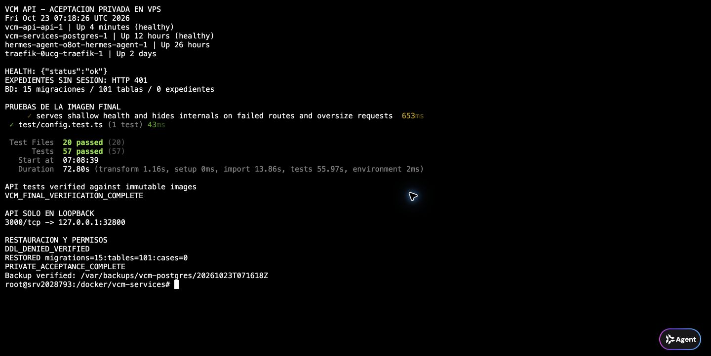

# Verificación de la API compartida VcM — 23 de octubre de 2026

Estado de entrega: API implementada, revisión independiente corregida y servicio privado instalado y verificado en el VPS. Conexión web/Hermes y publicación HTTPS corresponden a entregas posteriores.

## Alcance

API NestJS y PostgreSQL relacional: sesiones humanas, claves de servicio separadas por alcance, confidencialidad por objeto, versiones e idempotencia, expediente trazable, QA, planes/proyectos/tareas, decisiones y finanzas, campañas/contenidos/paquetes, indicadores/cortes, consultas semánticas, importación revisada, exportación autorizada y SSE durable.

La web corresponde a Hostinger Apps y aún conserva su persistencia local. No se ha conectado a esta API. Esta entrega tampoco instala la skill de Hermes ni activa worker/crons o efectos externos. Se conservan las conexiones Drive/Notion/Buffer existentes de Hermes, sin usarlas desde este backend.

## Evidencia local

- API: 57/57 pruebas, 20 archivos, PostgreSQL 18.4 real en bases aisladas.
- BD: 36/36 pruebas, 15 archivos, PostgreSQL 18.4.
- Frontend previo al pase final: 257/257 pruebas, 57 archivos; build correcto. El pase correctivo afecta servidor y arnés de pruebas SQL.
- TypeScript de servidor y compilación correctos. ESLint: 490 archivos, cero errores. `git diff --check` correcto.
- OpenAPI generado desde el registro ejecutable y los DTO de solicitudes; ejemplos y contrato de lecturas en `server/README.md`.
- Recorrido HTTP completo: entrevista → contradicción/resolución → revisión humana → plan/mandato/presupuesto → ejecución/gasto → QA/cierre → aporte 4.2.5 → corte. El historial persiste al recrear la API.
- Los arneses locales preservan explícitamente el código de salida del runner después de detener PostgreSQL. Se comprobó con un fallo intencional: antes salía 0 por `async-exit-hook`; corregido sale 1.

## Revisión independiente y correcciones

Una revisión de toda esta entrega encontró un hallazgo crítico y ocho importantes, sin menores. Se corrigieron en un único pase, con regresiones y suite completa. No se solicitó una segunda revisión.

| Hallazgo | Corrección y evidencia |
|---|---|
| Confidencialidad perdida al importar | Upsert conserva nivel revisado; expediente y documento sensibles siguen sensibles; otro servicio recibe 404. |
| Responsable retirado conserva acceso | Expira asignación cuando se envía null; escritura del anterior responsable denegada. |
| Cierre compite con revocación | QA de transición, aportes y cortes comparte bloqueos de proyecto; barrera comprueba orden de commits. |
| Paquete sustituido autoriza una solicitud concurrente | Bloqueo de paquete y relectura de revisión; sustitución espera a la operación vigente y solicitudes posteriores se rechazan. |
| Tarea con responsables devuelve 500 | Objetivo explícito del upsert; alta y reasignación comprobadas. |
| Gasto archivado reaparece en consultas | Predicado de vigencia compartido por filas, relaciones, sumas y exportación. |
| Otro cliente no recupera lo que debe aprobar | Detalles de planes, decisiones y proyectos incluyen propuestas/revisiones, mandatos y autorizaciones visibles. |
| Organización oculta revela referencias | Filtrado individual y autorización al capturar/vincular; IDs ocultos ausentes. |
| Relaciones cortadas sin aviso | Cursor por padre/relación/identidad; prueba recorre 11 tareas en dos páginas. |

También se ligó el mandato a la revisión exacta de la decisión de flujo y su base presupuestaria; devolver/revisar el flujo invalida la autoridad anterior. QA usa la misma vigencia que ejecución. Las lecturas REST omiten referencias a objetos invisibles.

El revisor no certificó frontend previo, migraciones 0001–0008, VPS real, instalación Hermes, worker, conectores ni HTTPS. Los primeros estaban fuera de su rango; lo operativo se verifica por separado. JSON autorizado no constituye restauración exacta: esa garantía corresponde a `pg_dump`/`pg_restore`.

## Evidencia de recuperación inicial en VPS

PostgreSQL 18.6. Imagen preliminar: 46/46 pruebas. Respaldo real `/var/backups/vcm-postgres/20261023T021731Z`, manifiesto SHA256 comprobado. Restaurado en `vcm_api_stage_20261023022227`, seguido de migraciones 0009–0015: 15 migraciones aplicadas, 101 tablas de negocio, cero expedientes. La base principal no se reemplazó para el ensayo.

Paquete final transferido sin secretos: SHA256 `486990255a866b0e3399a7b9ea81bb22e1a9db235f7398d8e59dbe9062fdded9`. Las imágenes de verificación y ejecución deben llevar ese mismo sello y desplegarse por su ID inmutable.

## Límites y publicación

Solo acceso privado previsto en `127.0.0.1:32800`; SQL sin puertos públicos. Antes de publicar se deben verificar el origen real de Hostinger Apps, las cuentas humanas iniciales, el proxy HTTPS y un destino de respaldo externo con retención. No existe CORS comodín, usuario inicial por defecto ni clave pública de Hermes.

La importación activa maestros, expedientes, fuentes/evidencias, proyectos/tareas y presupuesto planificado. Planes, decisiones, comunicaciones, gastos/compromisos, forecasts y cortes/aportes heredados inciertos permanecen íntegros en staging restringido y requieren reconciliación humana. El JSON de exportación intercambia datos autorizados; el respaldo SQL conserva el estado completo.

## Recuperación

Seguir `infra/vps/api/README.md` y `infra/vps/postgres/README.md`: verificar manifiesto y COMPLETE, crear una base nueva, restaurar dump con operador separado, comprobar migraciones/checksums y permisos, probar la imagen compatible, cambiar destino de aplicación y verificar health antes de conmutar. No restaurar encima de la base activa, no borrar volúmenes y no reiniciar Hermes.

Secretos previstos únicamente en el VPS: `/docker/vcm-services/secrets/api/database_url` y `cursor_key`, UID 1000/modo 0400 bajo directorio root 0700. Operador PostgreSQL separado en su fichero privado existente. El repositorio no contiene sus valores.

## Aceptación operativa final

La API está instalada y saludable en el VPS, sin ruta pública. Se reinició exclusivamente el contenedor `vcm-api-api-1` y `/health` volvió a devolver `{status:"ok"}`. Las rutas de expedientes sin sesión devuelven 401.

- Principal: 15 migraciones con checksums, 101 tablas, cero expedientes; no se importaron datos reales ni se crearon cuentas humanas/perfiles Hermes.
- SQL `vcm_api`: LOGIN, miembro solo de `vcm_runtime`; sin superusuario, CREATEDB, CREATEROLE ni BYPASSRLS, sin membresía migrator. Desde la conexión real se comprobó denegación de CREATE TABLE y de privilegio INSERT sobre usuarios; sesiones de aplicación sí permitidas.
- Contenedor UID/GID 1000:1000, raíz readonly, límite 512 MiB y CPU 0.5. Puertos: solo `127.0.0.1:32800 → 3000`; PostgreSQL sin publicación. Directorio secretos root 0700; ficheros API UID 1000/modo 0400.
- Imagen de ejecución: `sha256:808d6b8ed89469e48912bcdb22cb3dfd14d4340f9c3ec5fa9d2a48747bf5aec0`.
- Imagen de pruebas: `sha256:ec1f6b7637dd47f63a52d91a585d8980283e8204d6c6c9f0d2f4d526a3c2d4b7`; pasó 57/57 pruebas contra PostgreSQL 18.6 en el VPS.
- Backup previo a migrar: `/var/backups/vcm-postgres/20261023T071114Z`.
- Backup posterior: `/var/backups/vcm-postgres/20261023T071345Z`; restaurado en `vcm_api_restore_20261023071346`: 15 migraciones, 101 tablas, cero expedientes.
- Backup completo de SQL/configuración/secretos: `/var/backups/vcm-postgres/20261023T071618Z`. El script diario ahora incluye también la configuración de API y secretos dentro del bundle privado y su manifiesto; la copia externa sigue pendiente.
- Medición posterior al reinicio: API 62.41 MiB de 512 MiB, PostgreSQL 96.97 MiB; Hermes 835.8 MiB. Hermes mantuvo 26 horas de ejecución y Traefik dos días: ninguno se reinició incidentalmente.

El diccionario físico se regeneró desde PostgreSQL con las 15 migraciones: `docs/data/dictionary.md`, 101 tablas. Se conservan los cambios frontend anteriores fuera de los commits de esta entrega. No se ha hecho push, merge ni exposición HTTPS.

## Decisiones de implementación y costes

En orden del registro de ejecución:

1. Trabajar en la rama existente por la preferencia «acá» y preservar el frontend previo. Coste: árbol compartido; commits limitados a rutas propias.
2. Entregar API completa privada; conectar web, Hermes y worker en etapas posteriores. Coste: la web sigue guardando local hasta su conexión integral.
3. Reutilizar el binario PostgreSQL local verificado de `database`. Coste: instalar esas dependencias para pruebas locales; VPS usa PostgreSQL real existente.
4. Relaciones operativas con bandera activa, sin DELETE. Coste: todos los lectores deben aplicar vigencia.
5. Compilar dominio puro compartido fuera de React/Zustand en el layout documentado. Coste: conservar cwd y estructura al arrancar.
6. Añadir migraciones de autoridad operativa y privilegio de bloqueo sobre IDs de revisión, manteniendo triggers inmutables. Coste: migración adicional y pruebas como runtime limitado.
7. Distinguir revisión de plan y resolución de decisiones en el catálogo de acciones. Coste: mantener las transiciones por autoridad; Dirección no obtiene edición operativa por aprobar.
8. Persistir destino de presupuesto en revisión exacta de decisión. Coste: propuestas heredadas sin destino deben revisarse antes de ejecutarse.
9. Cursores SSE cifrados, ligados a sesión/credencial/permisos. Coste: clave privada persistente; cambiarla invalida cursores y requiere recarga.
10. No convertir aprobaciones históricas inciertas en autoridad real; conservarlas en staging. Coste: reconciliación/reingreso humano de esos dominios.
11. Separar exportación autorizada JSON de recuperación exacta PostgreSQL. Coste: recuperar todo el estado requiere el bundle privado, no solo JSON.
12. Recibo de backup emitido por operador, ligado a lote/base/esquema y una hora. Coste: paso operativo explícito antes de primera importación; fixtures sintéticos no acreditan recuperación real.
13. Exigir clasificación demo explícita cuando el formato antiguo no la trae. Coste: revisar el mapa antes de importar.
14. Puerto loopback efímero para pruebas locales. Coste: pequeña carrera entre liberar y usar puerto; cualquier fallo queda explícito.
15. Los siete portafolios usan IDs internos y etiquetas del prototipo acordado. Coste: no deben interpretarse como identificadores institucionales externos.
16. Archivar únicamente borradores sin dependencias formales; sin borrado masivo. Coste: restaurar archivos lógicos exige operador en esta etapa.
17. Secretos API UID 1000/modo 0400 dentro de directorio root 0700. Coste: recuperar respetando ambos niveles de protección.
18. Revisión independiente después de código local y antes del despliegue, sobre la base propia de esta API. Coste: evidencia VPS incorporada después; frontend anterior y revisión de BD previa no se vuelven a certificar.
19. Hallazgos críticos/importantes aceptados y corregidos; sin menores diferidos. Los puntos excluidos por el revisor se mantienen como límites explícitos o se verificaron operativamente, según la tabla anterior.
